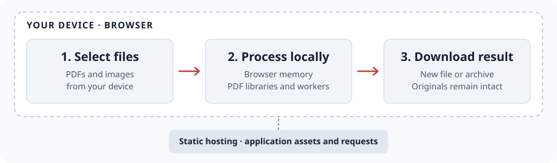

<div align="center">

<picture>
  <source media="(prefers-color-scheme: dark)" srcset="app/public/brand/logo-dark.svg">
  
</picture>

# PDF Tools

**Your documents. Your device. Your privacy.**

Free, open-source tools for working with PDFs in your browser.<br>
Merge, split, organize and convert documents without uploading them to a conversion server.

**[Launch PDF Tools →](https://akshat4112.github.io/pdf-tools/)**

[English](https://akshat4112.github.io/pdf-tools/) · [Deutsch](https://akshat4112.github.io/pdf-tools/de/) · [User guides](https://akshat4112.github.io/pdf-tools/guides/) · [Help](https://akshat4112.github.io/pdf-tools/help/) · [Privacy](https://akshat4112.github.io/pdf-tools/privacy/)

[](LICENSE)
[](https://github.com/Akshat4112/pdf-tools/actions/workflows/checks.yml)
[](https://github.com/Akshat4112/pdf-tools/actions/workflows/compatibility.yml)
[](https://github.com/Akshat4112/pdf-tools/actions/workflows/performance.yml)

[](https://akshat4112.github.io/pdf-tools/)

<sub>Project artwork. Explore the live application to see the actual interface.</sub>

</div>

## Why PDF Tools?

| Private by design | Free to use | Open source |
| :--- | :--- | :--- |
| Document processing takes place on your device. | No account, subscription, paid export or forced watermark for released browser tools. | Inspect the code, run it locally or contribute under the MIT license. |

PDF Tools creates new output files rather than modifying your originals. Browser and file limits apply; always review the exported result before sharing it.

## Available tools

All 14 tools listed here are implemented in the [tool registry](app/src/registry.ts) and available from the application.

### Organize and manage

| Tool | What it does |
| :--- | :--- |
| [Merge PDF](https://akshat4112.github.io/pdf-tools/merge/) | Combine PDFs in your chosen order. |
| [Split PDF](https://akshat4112.github.io/pdf-tools/split/) | Split by ranges, every N pages or individual pages; download a ZIP. |
| [Rotate PDF](https://akshat4112.github.io/pdf-tools/rotate/) | Rotate selected or all pages in 90° steps. |
| [Delete pages](https://akshat4112.github.io/pdf-tools/delete-pages/) | Remove selected pages into a new PDF. |
| [Extract pages](https://akshat4112.github.io/pdf-tools/extract-pages/) | Create a PDF from selected pages in your chosen order. |
| [Organize PDF](https://akshat4112.github.io/pdf-tools/organize/) | Reorder, duplicate, rotate and delete pages, with undo. |

### Convert and export

| Tool | What it does |
| :--- | :--- |
| [JPG/PNG to PDF](https://akshat4112.github.io/pdf-tools/images-to-pdf/) | Turn images into a PDF with page-size, fit and margin controls. |
| [PDF to JPG](https://akshat4112.github.io/pdf-tools/pdf-to-jpg/) | Render selected pages as JPG images or a ZIP. |
| [PDF to PNG](https://akshat4112.github.io/pdf-tools/pdf-to-png/) | Render selected pages as PNG images with background options. |
| [PDF to text](https://akshat4112.github.io/pdf-tools/pdf-to-text/) | Export the existing text layer as UTF-8 text. |

### Enhance, read and inspect

| Tool | What it does |
| :--- | :--- |
| [Page numbers](https://akshat4112.github.io/pdf-tools/page-numbers/) | Add page numbers with position and starting-number controls. |
| [Text watermark](https://akshat4112.github.io/pdf-tools/watermark/) | Add text with position, opacity and page-selection controls. |
| [PDF reader](https://akshat4112.github.io/pdf-tools/reader/) | Navigate, zoom, search existing text, copy and print. |
| [Document information](https://akshat4112.github.io/pdf-tools/doc-info/) | Inspect metadata, page dimensions and document indicators. |

Choose a tool, select your files, configure the operation, and download the result. Use **Clear files** or **Start over** to clear the workspace.

[Browse all tools →](https://akshat4112.github.io/pdf-tools/#tool-catalog)

## Privacy and security

Document contents stay within the browser's processing boundary. There is no document-processing backend in the released application.



| Data handling | Current application |
| :--- | :--- |
| Document uploads to a processing server | Not required by released tools |
| Accounts | Not required |
| In-app analytics and crash reporting | Not included |
| Document persistence in browser storage | Not intentionally persisted |
| Website hosting requests | Subject to GitHub Pages' data collection policy |
| Source code and tests | Publicly inspectable |

Selected documents, filenames, previews, extracted text and generated results are handled in browser memory. Loading the website still requests static assets; GitHub Pages logs visitor IP addresses for security ([hosting policy](https://docs.github.com/en/pages/getting-started-with-github-pages/what-is-github-pages#data-collection)). Local processing does not imply offline availability or anonymity.

Clearing a workspace releases application-managed state and resources. It is not secure memory erasure and does not remove original or downloaded files, clipboard contents or printed copies. Reader protections do not sanitize exported PDFs for other viewers.

**Inspect the evidence:** [Privacy notice](https://akshat4112.github.io/pdf-tools/privacy/) · [Trust and evidence](https://akshat4112.github.io/pdf-tools/trust/) · [Data lifecycle](docs/product/PT-PD-003-data-lifecycle.md) · [Local-processing audit](docs/security/PT-SEC-002-local-processing-audit.md) · [Rendering protections](docs/security/PT-SEC-001-rendering-and-filenames.md) · [Security reporting](SECURITY.md)

## Browser support and known limitations

Automated compatibility checks cover Chromium, Firefox and Linux WebKit engines, plus mobile browser emulation. These checks are not equivalent to testing physical iOS/Android devices, native macOS Safari, Windows Edge or assistive-technology hardware.

- **Inputs and limits:** PDF, JPEG and PNG as supported by each tool. Baseline quotas are 50 MiB per file and 300 PDF pages; tool-specific batch, pixel and processing limits also apply.
- **Text and images:** PDF-to-image renders pages rather than extracting embedded images; PDF-to-text uses existing text, not OCR. Complex reading order may vary.
- **Document fidelity:** modified copies may lose forms, bookmarks, annotations, accessibility tags or signatures. Document indicators do not validate certificate chains or signatures. Deleting pages or covering content is not secure redaction.
- **Not shipped:** password unlocking, OCR, compression, redaction, Office conversion and certificate signing.

See the [full limitations](https://akshat4112.github.io/pdf-tools/limitations/) and [help](https://akshat4112.github.io/pdf-tools/help/) before processing important documents.

## Run locally

**Requirements:** Node.js 24, npm. No API key, account or backend service is required.

```bash
git clone https://github.com/Akshat4112/pdf-tools.git
cd pdf-tools/app
npm ci
npm run build
npm run preview -- --host 127.0.0.1
```

Open [http://127.0.0.1:4173/pdf-tools/](http://127.0.0.1:4173/pdf-tools/).

For UI development, run `npm run dev` from `app/` and open [http://localhost:5173/pdf-tools/](http://localhost:5173/pdf-tools/). Use the built preview for complete processing checks.

The production output in `app/dist/` is a static site. For self-hosting, serve the complete build at the configured `/pdf-tools/` base path (including worker, font and other assets). See [app development documentation](app/README.md) for commands and prerequisites.

## Built for the browser

| Layer | Technology |
| :--- | :--- |
| Interface | React, TypeScript, Vite |
| PDF reading and rendering | PDF.js |
| PDF generation and manipulation | pdf-lib |
| Archive handling | zip.js, fflate |
| Automated testing | Vitest, Playwright, PyMuPDF, qpdf |
| Hosting | GitHub Pages |

PDF.js assets are served with the application. No document conversion service is required.

<details>
<summary><strong>Repository structure</strong></summary>

| Directory | Purpose |
| :--- | :--- |
| [app/](app/) | Browser application and automated tests |
| [docs/](docs/) | Architecture, product decisions, security and QA |
| [fixtures/](fixtures/) | Synthetic sample documents and expected outputs |
| [scripts/](scripts/) | Fixture generation, validation and security checks |
| [spike/](spike/) | Experimental prototypes; not production features |

</details>

## Quality and verification

The project uses automated checks to validate behavior, compatibility and output correctness. Real browser-generated downloads are independently read back with PyMuPDF and qpdf. CI also checks dependency licenses, integrity, vulnerabilities, privacy boundaries and startup budgets.

From `app/`:

```bash
npm run lint
npm test
npm run build
```

See [CI results](https://github.com/Akshat4112/pdf-tools/actions), the [output-validation matrix](docs/testing/PT-QA-001-independent-output-matrix.md), [synthetic fixture corpus](docs/testing/PT-PD-005-benchmark-corpus.md) and [supply-chain policy](docs/security/PT-SEC-003-supply-chain.md). The badges show actual workflow outcomes, not independent security or accessibility certifications.

## Project development

The live application contains the current released tools. The broader roadmap is subject to implementation and verification; planned features are not availability promises.

[Roadmap](ROADMAP.md) · [Changelog](CHANGELOG.md) · [GitHub releases](https://github.com/Akshat4112/pdf-tools/releases) · [Deployment history](https://github.com/Akshat4112/pdf-tools/actions/workflows/deploy-pages.yml)

A versioned GitHub release history has not yet been established; deployment and commit history provide the current release evidence.

## Contributing and support

Focused bug fixes, accessibility improvements, documentation and test cases are welcome.

- [Contributing guide](CONTRIBUTING.md)
- [Report a bug or suggest an improvement](https://github.com/Akshat4112/pdf-tools/issues/new/choose)
- [Support and troubleshooting](SUPPORT.md)
- [Security reporting policy](SECURITY.md)

Use small synthetic examples for reports. **Never attach private documents, personal information, credentials or sensitive screenshots to public issues or pull requests.**

## License and acknowledgements

The application code is [MIT licensed](LICENSE). Libraries and fonts retain their own licenses and distribution requirements; see the [dependency decisions](docs/architecture/PT-PD-006-dependency-decisions.md) and [brand assets](app/public/brand/README.md).

Thanks to the open-source communities behind React, TypeScript, Vite, PDF.js, pdf-lib, zip.js, fflate, and the testing tools that make this project possible.

---

<div align="center">

[Launch PDF Tools](https://akshat4112.github.io/pdf-tools/) · [Documentation](https://akshat4112.github.io/pdf-tools/guides/) · [GitHub](https://github.com/Akshat4112/pdf-tools)

<sub>Free PDF tools. On your device.</sub>

</div>
